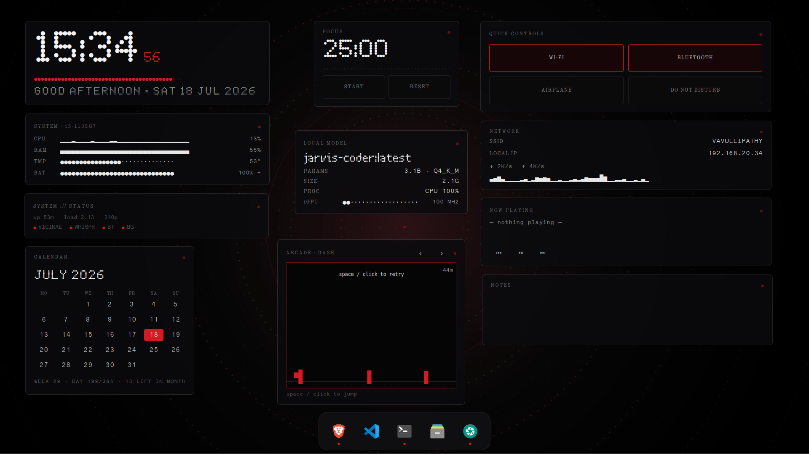

# Nothing OS — desktop

A Nothing-OS-themed interactive desktop for Linux Mint Cinnamon (X11): floating,
draggable GTK3 widgets over a live Conky background, in a dark **dot-matrix + red**
(`#D71921`) aesthetic. Everything is offline / local — no cloud calls.

 



## What's in it

**Widgets** — `nothing-widgets/nothing-widgets.py` (PyGObject/GTK3, one movable window each):

| Widget | What it shows |
|---|---|
| **Clock** | Ndot time + live seconds bar + greeting/date |
| **Quick Controls** | Wi-Fi / Bluetooth / Airplane / Do-Not-Disturb toggles |
| **System** | CPU & RAM sparklines, TMP/BAT dotted meters (pure `/proc` reads) |
| **Network** | SSID, IP, live ↓↑ throughput + sparkline |
| **Now Playing** | playerctl track + controls + audio visualiser |
| **Status** | uptime / load / procs + service dots |
| **Calendar** | dot month grid, today lit red, derived "agenda" line |
| **Focus** | Pomodoro countdown (start / pause / reset) |
| **Local Model** | live Ollama status (model · params · size · CPU/GPU) + iGPU freq |
| **Notes** | editable, autosaved to `notes.txt` |
| **Arcade** | switchable mini-games: DASH · SNAKE · REFLEX · RAIN |
| **Clean** | reclaimable-space scan, one-touch cache clean, 7-day memory timeline |
| **Dock** | macOS-style live dock — open apps + pins, click to focus/launch |

**Background** — `conky/bg.lua` + `bg.conf`: CPU-reactive dotted rings, a drifting
dot field, and sonar pings (Cairo, ~5fps).

**Extras** — `bin/shot` (screenshot → save **and** clipboard), Vicinae config
(`config/vicinae-settings.json`, close-on-focus-loss), autostart entry.

## Interaction

- **Double-click + drag** a widget to move it (position persists per widget).
- **Double-click** (no drag) opens the related app.
- **Arcade**: click the board to focus, then arrows/WASD or space.
- **Notes**: click to type (the one focus-taking widget).

## Keybindings (Cinnamon)

| Key | Action |
|---|---|
| `Alt+Space` | Vicinae launcher |
| `Ctrl+Shift+S` | area screenshot |
| `Ctrl+Esc` | close active window |
| `Super+Shift+V` | Vicinae clipboard history |

## Install

Tested on Linux Mint 22.3 (Zena) · Cinnamon · X11.

**1 — System packages** (Debian/Ubuntu/Mint):

```bash
sudo apt install python3-gi gir1.2-gtk-3.0 conky-all playerctl \
                 wmctrl xclip gnome-screenshot papirus-icon-theme
```

**2 — Clone & deploy:**

```bash
git clone https://github.com/Arj0010/nothing-os.git
cd nothing-os
./install.sh          # copies widgets/bg/tools into ~/.config + ~/.local/bin
```

**3 — Fonts.** The dot-matrix look needs Nothing's **Ndot** & **NType 82** plus
**Lettera Mono**. These are proprietary and **not** bundled — download the `.otf`
files yourself, drop them in `~/.local/share/fonts/`, then (Space Mono *is*
bundled):

```bash
cp fonts/*.otf ~/.local/share/fonts/ && fc-cache -f
```

Without them GTK falls back to a plain monospace — it still works, just less Ndot.

**4 — Icons** (colorful dock):

```bash
gsettings set org.cinnamon.desktop.interface icon-theme Papirus-Dark
```

**5 — Launch:**

```bash
~/.config/conky/nothing/start.sh
```

Autostart (`nothing-conky.desktop`, installed in step 2) relaunches everything
~6s after each login. Optional keybindings (Alt+Space, Ctrl+Esc, …) are set
through **Cinnamon ▸ Keyboard ▸ Shortcuts** — see the table above.

## OPTIMISE :// widget

The rail card is now an `AGENT WORK` optimizer for Claude/Codex terminal-heavy
engineering. It discovers every Claude/Codex tree (including Python, Node, Java,
test-runner, and compiler descendants) as Primary. Brave and VS Code stay
Interactive; Spotify, VLC, and Telegram keep a media/comms lane.

- **Modes:** Auto is the login default; Perf, Battery, and Focus temporarily tune
  relative CPU, I/O, soft memory-pressure, and power-profile policy. They never
  terminate applications. `EDIT PRIORITY` temporarily makes one resolved app the
  Primary lane; `AUTO · CLAUDE + CODEX` restores the built-in profile.
- **Meeting Guard:** Brave is promoted to Meeting when capture is attributed to it,
  or whenever active capture attribution is uncertain. It is never automatically
  paused, throttled, ended, or forced.
- **Deep Focus:** available only in Focus. It reversibly pauses eligible Background
  groups and a crash guard restores only identities this controller confirmed it
  paused. Primary, Meeting, Protected, and active media/comms lanes are not targets.
- **App Control:** groups are identified by current `(pid, start_time)` identities,
  never a short process name. Pause/Resume is reversible. End is manual and asks
  for confirmation; Force appears only after that exact graceful End leaves live
  survivors and asks again. Protected, Primary, and Meeting rows are status-only.
- **Network:** `NETWORK · BASIC` means the core is running safely without per-app
  traffic shaping. Full egress prioritization needs the separate, opt-in privileged
  helper; the UI will not claim it until the helper proves its owned rules are live.
- **Cleaner is separate:** `OPEN CLEANER` contains storage reclamation only. Held
  targets remain protected, all deletion paths are guarded, and no cleaner action
  kills a process.

The two root-owned targets (apt cache, journal) need a pinned sudoers rule:

```bash
./install.sh --with-cleaner-sudo     # validates with visudo before installing
```

Without it those rows read `AUTH` and `CLEAN NOW` skips them — nothing hangs.

## System updates

An `apt` upgrade never touches `$HOME`, so the widgets, conky config, fonts and
Vicinae settings are not at risk. Two things are:

1. **`/etc` files you have modified** — dpkg offers to replace them. On this
   machine that's `zram-generator.conf`, `default-wifi-powersave-on.conf` and
   `cryptsetup-initramfs/conf-hook`.
2. **Cinnamon dconf settings** — panel layout, keybindings, themes. Safe in
   practice, but worth being able to prove.

Both are recorded in `docs/desktop-state/`, and:

```bash
./bin/mint-update --dry-run        # see what would change
./bin/mint-update                 # upgrade, keeping every /etc file you edited
./bin/mint-update --prune-kernels # drop old kernels, keep running + 1 fallback
./bin/verify-desktop              # report drift against the recorded baseline
./bin/verify-desktop --update     # accept current state as the new baseline
```

`--prune-kernels` exists because `apt autoremove` will not remove them: a kernel
that was ever installed explicitly is marked MANUAL, and autoremove only reaps
automatic packages. That left 5 old kernels and ~845 MB on a 90%-full disk here.
It always keeps the running kernel plus the newest other one, and refuses to run
if the running kernel somehow lands in the removal list.

`mint-update` runs `apt upgrade` (never `full-upgrade`, which can remove packages
to satisfy dependencies), passes `--force-confold` so your config files win, lists
anything held back rather than forcing it, and finishes by running
`verify-desktop`. Where dpkg keeps your file it parks the new one as
`*.dpkg-dist`, and the script points them out.

It needs your sudo password. In a terminal it asks there; with no controlling
terminal — an agent, a hotkey, a `.desktop` launcher — it pops a zenity dialog on
`$DISPLAY` instead, because `sudo` otherwise aborts with "a terminal is required"
before doing any work.

## Local-model tuning

```bash
./bin/llm-tune status   # power profile, AVX-512 features, zram, Intel GPU stack
./bin/llm-tune on       # performance power profile
./bin/llm-tune off      # back to balanced
./bin/llm-tune bench    # single-thread STREAM triad
```

Needs no sudo — `power-profiles-daemon` exposes this over polkit to the active
session. That's also *why* it uses `powerprofilesctl` rather than writing
`scaling_governor`: PPD is what actually sets CPU policy here, so hand-written
sysfs values get reverted the next time the daemon re-asserts itself.

Measured on this machine (i5-1135G7, on battery): balanced **15.0 GB/s** →
performance **17.4 GB/s** single-thread triad, with core clocks going 2900 →
3800 MHz. CPU inference is memory-bandwidth-bound, so that bandwidth number
tracks tokens/sec more closely than clock speed does.

`vm.swappiness` is deliberately left at 140. It looks alarming next to the stock
60, but this machine swaps to zram (8 GB, compressed RAM) and a high value is the
correct pairing. Lowering it trades "model pages get compressed" for "model pages
go to disk", which is worse.

## Backup workflow

Live files are edited under `~/.config`; `./sync.sh` copies them back here, then
commit + push. Runtime state (`positions.json`, `notes.txt`,
`cleaner-history.jsonl`) is git-ignored.

## Requirements

Cinnamon/X11, `python3-gi` (GTK3), `conky-all` (Lua+Cairo), `playerctl`,
`wmctrl`, `xclip`, `gnome-screenshot`, Papirus-Dark icons, and the Ndot / NType /
Lettera fonts in `fonts/`.
